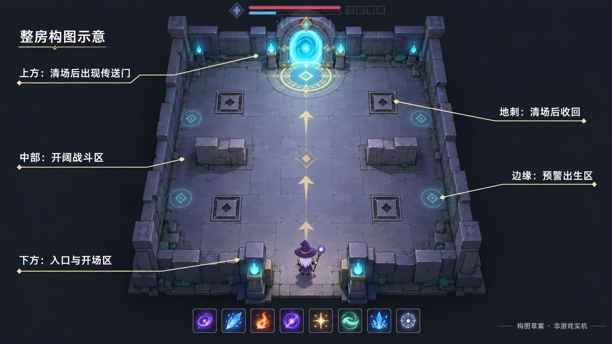
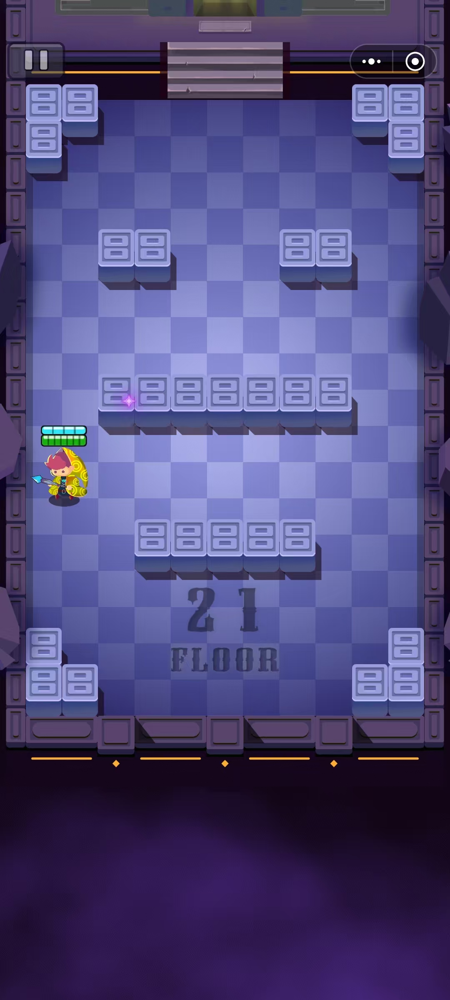
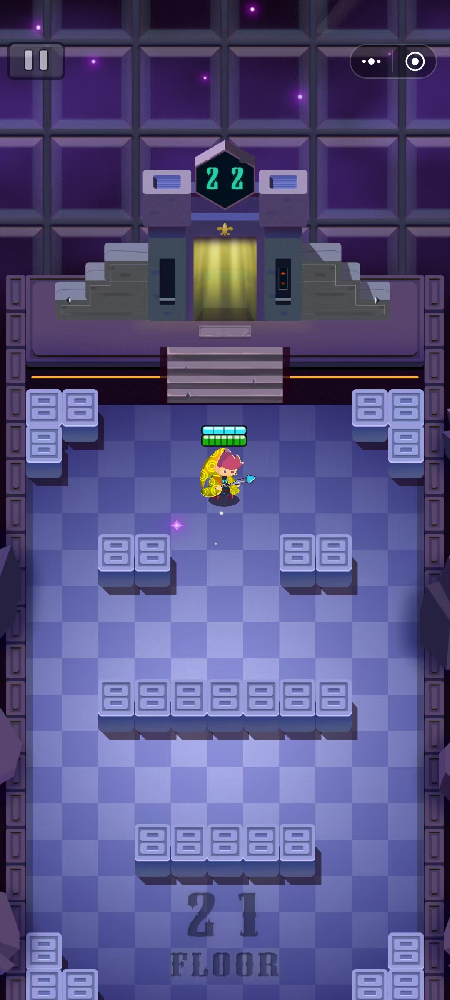
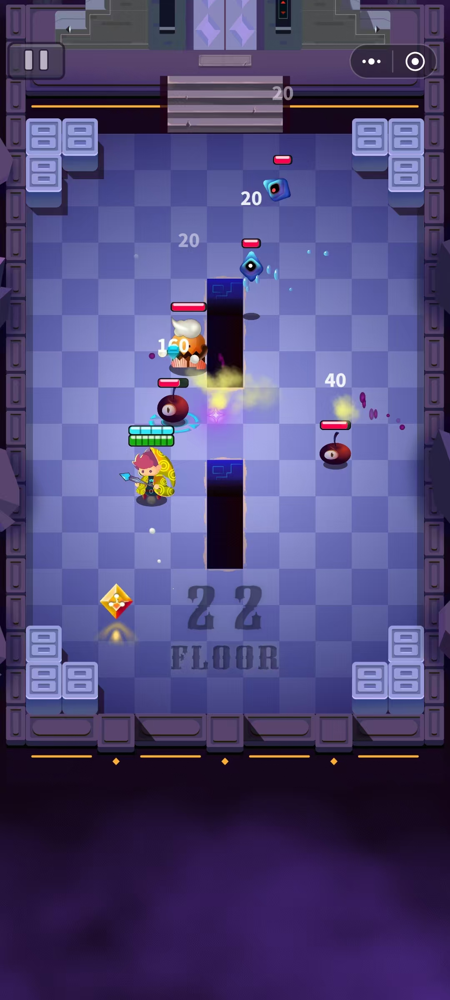
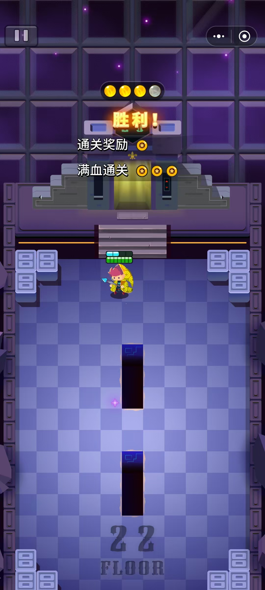
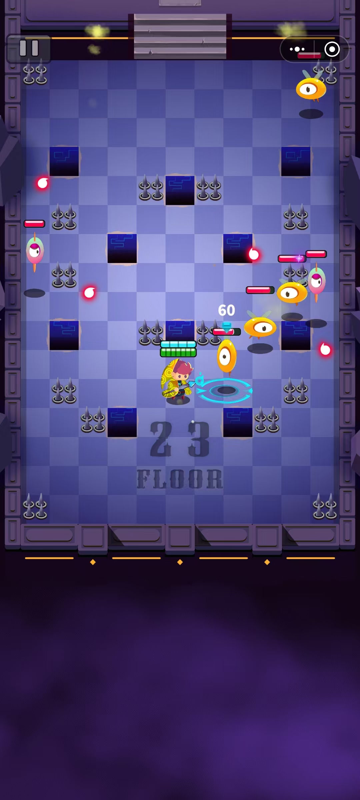

# 六十房流程与场景参考

**阅读范围（文档整理）**：本页保留场景参考、原三Boss框架及12×14米／地刺等规划的历史原文；其中“目标尚未接入／精英占位”不再描述当前版本。现已接入60房、四Boss、双奖励和五店，见[关卡与敌人](../关卡与敌人.md)；旧尺寸、节点、奖励及地刺候选不覆盖实际data，地刺仍未制作。

**设计定位（2026-10-20核对）**：设计目标／初版基线，当前实现以[功能模块](../../功能模块.md)和实际data为准。
最新用户目标为四阶段及15／30／45／60四Boss房，清场固定法术书＋必金箱，包含60房；先确定非Boss难度再定Boss。下文原三Boss与末房无奖励框架保留原阶段范围，新目标尚未接入，见[设计09最新章节](09-普通房配置与难度节奏.md#nonboss-difficulty-direction)。
当前已补齐60房并以精英房充当Boss，54房后第五店同步开放，按用户要求暂不实机测试，见[历史20](../../历史决策/归档/20-六十房路线补齐.md)。本页正式首领与12×14空间内容仍是目标或历史规划。当前独立首房和六模板路线的组合、拾取与节点由courtyard_route.json及runtime拥有；已制作的阶段末遭遇为强化精英混编，不能据原目标标为正式Boss。2026-10-18扩展至45房，见[历史08](../../历史决策/归档/08-四十五房扩展与宝物定位.md)；2026-10-19接入9／24／33／42房后四间独立商店，沿用本页不占战斗房号的框架，见[历史18](../../历史决策/归档/18-前四十五房商店接入.md)。

日期：2026-10-17。用户已确认15／45／60房首领框架、下表精英与商店位置、怪物设计，以及酒馆每店免费回血并增加本局生命上限、宝物用金币购买。酒馆沿用原五个商店节点；独立房间和法术奖励节奏沿用此前确认。基础恢复数值、21件宝物及金币商店方案已获同意，具体见[基础数值](05-首版数值与验证.md)与[经济基线](07-金币商店与品质.md)。本页原首房阶段说明保留历史，最新制造范围见下文导航，现行状态以[功能模块](../../功能模块.md)为准。

2026-10-17最新场景选择：用户在查看首房后明确选择更长、更大的房间、镜头跟随莉奈，并授权补入口来路和墙外遗迹。当前首房改为18×28米，保持南入北出与两只M01教学，入口到门的真实路径更长；相机分段揭示来路、中央战斗区和北门。墙外侧廊／残垣和门后旧步道用于连续环境，不是额外可走房间。当前首房空间唯一配置见[first_room_runtime.json](../../../data/first_room_runtime.json)；下文4.3—4.8的12×14整房构图、三布局和隔离计算保留当时规划依据，不能当作本轮跟随镜头或大房间验收。

## 1. 房间与奖励的统一含义

最新制造范围与技术证据见[功能模块](../../功能模块.md)。用户此前认可的四项结果只覆盖原15房的门前领取、完整计时、选择反馈与分段压力；不会因路线继续扩展而自动成为16—45房体验认可。33图标＋1透明火舌及立体特效、后续卡牌与槽位素材已接入，新美术待用户查看。下文60房、正式Boss／商店和旧12×14配置保留目标／历史用途；当前组合与拾取节点见[courtyard_route.json](../../../data/courtyard_route.json)，不要据旧空间表回写当前地图。

- 一个房间对应一次独立战斗，可能含不同敌人，但不是把同一房内多波敌人称为多个房间。
- 每房清空后补满护盾；生命保持当前值。酒馆位置与每店一次免费补给已定，回复及成长幅度为数值候选；15／45房首领战后恢复沿用本版建议。
- 用户追加确认法术只回复护盾，不恢复生命；首领关与商店的生命恢复保留。新F10用于提高房内容错，不改变房间清场补满护盾的规则。
- 开局随机三选一基础法术；第一次奖励需清一个房，第二次需再清两个，第三次需再清三个，此后间隔固定三个。

| 阶段 | 本次需要清房数 | 累计清房数 | 法术成长 |
|---|---:|---:|---|
| 出发前 | 0 | 0 | 开局基础法术三选一 |
| 第一轮 | 1 | 1 | 三选一 |
| 第二轮 | 2 | 3 | 三选一 |
| 第三轮 | 3 | 6 | 三选一 |
| 后续轮 | 3 | 9、12、15…… | 每轮三选一 |

此表解释已确认的法术奖励间隔，套用到本轮采用的60房框架。三次成长既可能拿三种不同法术，也可能重复升级，不能保证累计第三房就凑出三火效果。

### 1.1 已确认的阶段框架

| 阶段 | 房间 | 房数 | 首领 |
|---|---|---:|---|
| 前期 | 1—15 | 15 | 第15房 |
| 中期 | 16—45 | 30 | 第45房 |
| 后期 | 46—60 | 15 | 第60房最终首领 |

这是整局的阶段框架，不代表每阶段都要独立制作整套美术资源；当前60房及五间商店已接入，正式首领仍由强化精英占位，详见功能模块。

### 1.2 已确认的精英与商店节点

用户已确认按下表节点安排，商店插在60个计数战斗房之间，不占房号；商店固定出现，可选择停留或直接离开。商品、恢复量及奖励分配仍按各自状态记录。

| 阶段 | 精英房 | 商店：清完哪房后出现 | 首领 |
|---|---|---|---|
| 前期1—15 | 6、12 | 9后 | 15 |
| 中期16—45 | 21、30、39 | 24后、33后、42后 | 45 |
| 后期46—60 | 51、57 | 54后 | 60 |

- 共7个精英房、3个首领房，其余50个为普通战斗房；额外有5个商店停留节点。
- 前期第6房建立第一次精英／宝物体验，第12房检验初步构筑，再用两个普通房过渡到首领。不能要求该阶段已满八槽或激活指定相性。
- 中期以21、30、39三个精英节点形成小段，第30房承担阶段高潮；每个精英后经过三个普通房进入商店，补给与购买后再推进。
- 后期51、57精英逐步提高组合压力，54后商店是最后一个补给机会；57后仍有58、59两个普通房，避免精英与最终首领直接连战。
- 本版固定顺序，先复用普通敌人与房间模块组合形成精英压力；不要求7个精英各制作一个全新首领。

节点与本版怪物设计已确认；首版角色、精英分配和三个首领行为见[敌人与首领](04-敌人与首领.md)。

### 1.3 回血与补给

**用户已确认：**每个酒馆免费回血并提高本局生命上限，宝物用金币购买；法术只补护盾，首领与商店保留生命恢复。酒馆不新增房号，仍为下表五处。

**本版提案：**

| 时机 | 来源 | 恢复规则 |
|---|---|---|
| 9、24、33、42、54房之后进入酒馆 | 免费成长与补给 | 每店一次，先提高本局生命上限，再按新上限回复生命；商品购买不影响此次成长与恢复 |
| 15、45房首领成功清场后 | 首领战后恢复 | 自动回复部分生命，单次恢复量高于商店，帮助进入下一阶段 |
| 60房最终首领成功清场后 | 最终结算 | 直接进入胜利结算，不安排无后续用途的本局回血或法术选择 |

- 回复量按最大生命比例配置，均只恢复到生命上限；具体比例和每店上限增量已有首版候选，实际依据data/balance_candidates，不在本页另存默认值。
- 酒馆成长与回血仅限本店一次，退出重进、反复打开界面或重复互动不再获得。满旧生命上限也能得到本店上限成长与补给；补给后视为已结算，不储存。跳过酒馆会同时失去本店成长与恢复。
- 增加生命上限本身不另外补一份当前生命，再单独执行免费恢复；用户已同意首版基础数值、三件属性宝物和[金币、商店与品质](07-金币商店与品质.md)，不假定三件通用每局必出。酒馆免费成长／恢复先结算，再购买；当店买到生命上限宝物不追补已结算的恢复。
- 精英房没有固定生命恢复，常规清场仍只补满护盾；这样精英是获得成长的挑战，不同时承担免费补血职责。
- 首领回血必须发生在玩家存活且战斗胜利之后，不能用战后恢复抵消已经发生的死亡。
- 从出发到终点，相邻补给机会间隔为9、6、9、9、9、3、9、6个战斗房，最长9房；最后一项是54后商店到60房终点。玩家主动跳过商店会扩大实际回血间隔。
- 不额外增加泉水、休息房或额外付费回血服务。需要改变补给密度时，优先调整现有商店与首领恢复，而非新加一套系统。

### 1.4 法术、宝物与节点结算

- 建议普通、精英和首领共用一个清房进度；普通法术奖励仍是1、3、6、9……。精英与首领不另追加一轮法术选择，避免改变已讨论的成长密度。
- 7个精英以及15、45房首领各提供一次宝物箱奖励机会，总计9次，商店购买另算；箱子至多三个合法候选选一，不足时展示实际数量。前期以蓝色为主，中后期提高紫、金基础权重，具体概率及保证见已同意的[经济基线](07-金币商店与品质.md)。
- 不把中后期每个箱子都锁死成单一品质。已同意火系配套蓝10／紫5／金3、通用蓝2／紫1，共21件；专属件受法术条件限制，通用属性三件无系列条件。已持有和条件不符者先排除，目标品质不足时使用其他合法正权重品质，全部耗尽时提示跳过。新的有限池投放模型与实际展示率见07，条目确认不等于掉落体验已认可。
- 同一清场先结算护盾及应有的首领回血，再完成普通法术选择，随后提供宝物选择；先选法术能让新获得法术的配套宝物进入当前合法池。处理完后再进入商店或下一房。
- 同一房只结算一次。最终第60房走最终结算分支，不重复普通局内奖励流程；已同意的[局外基线](08-局外成长触媒与宝石.md)另定义魔尘，在整局结算发放，不与本局金币互转。

用户已同意[普通房配置与节奏](09-普通房配置与难度节奏.md)：50个普通房采用教学单怪、四类组合、至多两批与首领前缓和。房内批次不增加房号、选择或金币次数；全房清空才补满护盾，不在批间重置法术冷却。数量与动态增援已有独立模型，具体空间／走位尚待设计与白盒试玩。

### 1.5 本版核对与待验证

确定性计数核对：60房＝50普通＋7精英＋3首领，5个商店不占房号；7个生命恢复机会的最大间隔为9个战斗房。按不额外追加法术奖励的提案，三个首领之前含开局仍分别有6、16、21次法术选择，最终首领前共20次清房法术奖励。

节点与计数已经核对；数值阶段另执行了输出、首领耗时、酒馆成长及生存账本模型，详见首版数值。实际精英难度、每房耗时、生命损耗、金币购买力及完整构筑体验仍未实机验证。试玩应观察到酒馆前的生命与上限、溢出恢复、是否经常在补给前死亡，以及第30房前后的阶段变化，再调整位置或幅度。

## 2. 五张参考图的可用信息

用户说明参考原型采用简易3D；图片展示的是其最终画面。这里借鉴房间结构、可读性和复用方法，不从截图推断其内部碰撞或法术规则。

| 参考 | 可直接观察的内容 | 对本项目的意义 |
|---|---|---|
| [01 障碍阵列](../参考图/01-障碍阵列.jpg) | 同一地板上排列短墙、长墙和角落砖块，保留通道 | 少量同规格模块可以产生多个战斗布局 |
| [02 出口与复用](../参考图/02-出口与复用.jpg) | 顶部门、台阶、层数标记与同一套砖块，人物接近出口 | 房间主体复用，通过出口状态和编号说明推进 |
| [03 柱体战斗](../参考图/03-柱体战斗.jpg) | 中央柱体分割地面，敌人、弹体、伤害字与人物条并存 | 障碍周围仍需清楚展示敌人和攻击，碰撞与遮挡要各自明确 |
| [04 清场反馈](../参考图/04-清场反馈.jpg) | 场地延续，胜利与奖励出现，角色生命和护盾有剩余差别 | 清场状态、奖励与继续前进需要同一套清楚反馈 |
| [05 地刺与通道](../参考图/05-地刺与通道.jpg) | 同套柱体与地刺组合，场地留有可走路径 | 地形变化可来自布置；加入陷阱后必须重新验证普通移动的避险空间 |

图片是布局和视觉参考，并不自动要求实现图中的地刺、楼层数量、货币、UI平台按钮或原角色。参考图只保存在设计目录，由.gdignore隔离。

## 3. 制作路线比较

| 路线 | 本项目需要增加的工作 | 时间判断 | 本稿意见 |
|---|---|---|---|
| 沿用2D模拟，做固定俯视的2.5D视觉 | 横屏地面、墙和柱的分层图、阴影、脚底排序、平面障碍 | 相对最低；可以复用现有Node2D入口、模拟坐标与UI | 优先建议 |
| 2D模拟配3D场景渲染 | 增加3D视图，并解决2D地面到3D位置、特效投影、遮挡和输入的一致性 | 中等至高；已有可用场景资产时才值得评估 | 当前没有场景资产支持，不先展开 |
| 全部改为3D战斗场景 | 重接角色／敌人、碰撞、导航、摄像机、弹体、范围与画面检查 | 相对最高；会增加与火系内容无关的改造 | 两天首关不优先选择 |

判断依据：当前[五法术场景](../../../scenes/build_trial.tscn)的根节点是Node2D；project.godot为1280×720横屏、GL Compatibility。本机Godot MCP只读核对版本为4.7.2。本轮没有启动编辑器、运行游戏或解析新脚本。

Godot官方文档提供[2D场景、精灵、粒子与光照能力](https://docs.godotengine.org/en/stable/tutorials/2d/introduction_to_2d.html)，也支持[2D光照与阴影](https://docs.godotengine.org/en/stable/tutorials/2d/2d_lights_and_shadows.html)。这些能力支持沿现有2D路线制作有体积感的画面；“更适合本轮期限”是结合当前工程的制作判断，不是文档保证的工期。

## 4. 横屏地图需求

### 4.1 用户已确认

用户要求先对齐地图需求，再制作具体方案。本节记录其逐项确认的功能需求；用户随后强调优先确定地图尺寸，其余由助手自行收敛。尺寸建议及授权内默认项见4.3，不把助手选值记成用户逐项体验认可。

| 方面 | 已确认需求 |
|---|---|
| 视野 | PC横屏，独立战斗房固定一屏看全，玩家能观察全房怪物、地刺与出生预警 |
| 走位体验 | 开阔走位为主，少量障碍改变局部路线，保留连续绕行和躲招退路 |
| 障碍作用 | 统一采用实体掩体：阻挡玩家、怪物移动，也阻挡双方直射攻击 |
| 法术交互 | 按攻击类型区分：双方直射受阻，落点法术和范围伤害可以越过掩体；此前另定事项现已确认 |
| 地刺形式 | 固定布置，底座始终可见，周期预警、伸出伤人、收回；此前“地磁”为用户笔误，统一改称地刺 |
| 地刺对象 | 只伤害玩家，不伤害怪物，承担额外走位压力 |
| 地刺出现范围 | 多数战斗房都有，可与精英和首领组合；不能沿用“只在少量普通房、精英首领不放”的助手建议 |
| 玩家开场 | 从固定入口附近开始，有可识别的开场安全区域，敌人不会贴身出生 |
| 普通怪与增援 | 从房间边缘的固定出生区域预警后入场，玩家能识别出怪方向；数量和批次节奏沿已同意的09 |
| 整房推进 | 下方进入、中部战斗、上方传送；清场后上方出现传送门／法阵，玩家走入后切换下一场景。先看整房构图，再按构图重新确定尺寸 |

### 4.2 历史空间评审的收敛范围

- 当时用户授权按12×14米确定布局、地刺参数与怪物出生规则，三类模板、实际坐标、60房分布和边界处理见4.4—4.7。09当时同意的数量／组合／批次保留设计依据，现行六模板路线不沿用本节几何。
- 保持既定交互：直射受阻、落点与范围可越掩体；清场先停地刺／敌攻、补盾／恢复／奖励，再启用上方传送，不再逐项询问默认项。
- 该空间评审完成隔离的几何连通、脱离距离、出生抽样、地刺受击和重型错峰核对，证据与限制见4.8；模型不包含当时尚未制作的Godot碰撞、怪物寻路或真实单房，不据此否认后续已实现的首房与路线。
- 表现沿现有2D分层与已批准资源；仍需接入后检查真实像素、完整攻击组合、掩体后的自动选敌和用户体验。整房概念图认可不扩大成图内独立素材或新动作批准。

### 4.3 首版尺寸建议与默认项

用户确认“下方进入、中部战斗、上方传送”，要求先看整房构图，再重新定尺寸，其余由助手收敛。用户现明确反馈“这个我很满意”，因此这张**清场后状态**整房构图作为后续制作方向：下方入口安静，中部开阔，侧边少量掩体／地刺，上方传送门成为最亮的目标。该认可不等于Godot地图、图内独立素材或实机体验已验收。

图片由内置image_gen生成，[完整提示词](../参考图/06-整房构图-v2-prompt.txt)随图保存。金色箭头只解释推进方向，不是游戏里的固定跑道；图中地刺已收回、没有活怪。角色、法术图标及装饰只作构图占位，不新增正式角色、动作或法系。概念图不是Godot截图，也不是可按像素量距的施工图。

在当时已认可构图下，**宽12米、深14米**作为历史白盒制作起点，后来已由扩房与当前路线替代；当时拟定普通／精英／首领共用外框，墙体与HUD另留空间，角色比例与实际走位另待接入验证。历史尺寸源为[map_metrics_v2.json](../../../data/balance_candidates/map_metrics_v2.json)，保持原字节；该12×14几何不是当前运行尺寸，文件被图鉴或兼容加载不代表尺寸仍沿用，v1也保留历史。

| 地面分区（从下往上） | 宽×深 | 用途 |
|---|---|---|
| 入口与开场区 | 12×2米 | 玩家从下方出现，开场不贴怪；不固定放地刺或出生区 |
| 中部战斗区 | 12×10米，120平方米 | 主战斗、少量掩体与固定地刺、侧边预警出生区；保持连续绕行空间 |
| 上方传送区 | 12×2米 | 战斗时留空／安静；清场后在中轴出现光门或法阵，完成奖励后可进入 |
| 整房可走地面 | 12×14米，168平方米 | 分区连通，没有三道门或强制通道；敌人可以追入入口和传送区 |

分区是构图与布置范围，不是永久安全区；开场安全和清场安全有明确时机。入口／传送区不固定铺刺或刷怪，不提供战斗中的无敌。传送门在清场前隐藏，不能在房间未清时提前过房；精英／首领同样按此流程，60房仍走最终结算，不生成无后续用途的下一房传送。

| 尺度与屏幕核算 | 本版结果 |
|---|---|
| 基准格与角色碰撞 | 1米格；沿用已有0.3米碰撞半径 |
| 整房角色中心活动范围 | 11.4×13.4米，尚未扣障碍 |
| 直线横穿／纵穿 | 2.28／2.68秒，沿用5米/秒，不含绕障与战斗 |
| 逻辑画布与HUD占位 | 沿用1280×720；拟定顶部64、底部84逻辑像素 |
| 拟定地面投影 | 横向56、纵深34逻辑像素/米，地面占672×476逻辑像素 |
| 拟定人物显示 | 莉奈绘制矩形缩到96逻辑像素高，保留贴图比例与脚底锚点；物理碰撞／移速不变 |
| 传送视觉占位 | 拟定最大156×120逻辑像素；仅清场后显示 |

核算覆盖拟定地面、人物边缘矩形、墙体外框与传送视觉框，四类均可容纳在HUD之间；上方目标和底部开场位置也处于画布内。[检查器](../../../tools/balance/first_run/check_room_composition.py)与[本轮结果](../../../build/qa/room-composition-20261017/results.json)保留输入哈希和直接几何／时间计算，旧v1结果可复现。该历史核算时新人物缩放和投影尚未实现；法杖／头顶条／首领／特效、绕障、出怪安全与所有攻击叠加均需真实Godot及试玩验证，不能由此宣称难度或可躲避性通过。

授权内默认项：清场成立且玩家存活时先关闭地刺与敌方攻击，出现上方法阵，再沿既有补盾／首领恢复／奖励顺序处理；奖励完成后启用传送，玩家走入切换下一场景。多数房间有地刺、只伤玩家、可用于精英首领不变。首版表现沿2D分层，传送先用简单光环／法阵，不要求制作复杂石拱、火盆或植被；图里的具体掩体和地刺摆法仅为构图示例；本次制作坐标与机关／出生规则以4.4—4.7的新空间源为准。

旧18×9方案只验证横向地面与人物矩形，未表达整房向上推进，被用户指出视觉引导不对后撤回；其[历史参数](../../../data/balance_candidates/map_metrics_v1.json)、[旧图](../../../build/qa/map-metrics-20261017/room_size.png)与[核算记录](../../../build/qa/map-metrics-20261017/results.json)原样保留，不作为当前推荐。

<!-- spatial-review:start -->
### 4.4 12×14米布局配置

用户当时授权按12×14米确定本节布局、地刺与出生规则；以下是当时授权内收敛的12×14历史配置，不作为当前扩房路线的运行几何。原设计调参源为[room_spatial_v1.json](../../../data/balance_candidates/room_spatial_v1.json)，本节与图由[生成器](../../../tools/balance/first_run/write_spatial_review.py)生成快照，不能把表格作为另一处编辑源。

坐标以房间中心为原点，x向右，z朝画面上方传送区；地面x∈[-6,6]、z∈[-7,7]，中部战斗区z∈[-5,5]。障碍只放中部，三个布局共用入口、传送和出生规则。

| 布局 | 实体掩体（中心x,z；宽×深，米） | 走位用途 |
|---|---|---|
| 边侧掩体 | (-3.5,0) 1×1；(3.5,0) 1×1 | 两侧各一块，中部大面积绕行；教学、缓和和首领优先 |
| 四柱绕行 | (-3.5,-1.5) 1×1；(-3.5,1.5) 1×1；(3.5,-1.5) 1×1；(3.5,1.5) 1×1 | 四根独立柱，两侧和柱间可穿行，用于追击／远程组合 |
| 错列短墙 | (-3,1) 2×1；(3,-1) 2×1 | 左右错列短墙，提供换侧掩护；保留中轴与两条外侧通路 |

三个布局中轴净宽4米；掩体至外墙、掩体之间最近实体间隔至少2米。沿用玩家半径0.3米、移速5米/秒。掩体挡双方移动与直射／直线束，落点与范围伤害可越掩体；不新增可破坏墙、门锁、窄走廊或第四种布局。入口／上方传送区可被敌人追入，仍不是常驻安全区。

### 4.5 地刺位置、周期与伤害

只摆放当前配置使用的底座；无刺房不放，教学放一块，稀疏放A两块，标准放A／B四块。已摆底座始终可见，收回时可行走；伸出时仍可穿行但会尝试伤害玩家，不形成新的实体障碍。地刺不伤害怪物。

| 项目 | 首版配置 |
|---|---|
| 单块与中心坐标 | 1×1米；SW(-3,-3.5)；SE(3,-3.5)；NW(-3,3.5)；NE(3,3.5) |
| 四种逐房配置 | 无刺；单块教学SW；稀疏组SW＋NE；标准组A=SW＋NE、B=NW＋SE交替 |
| 时序 | 进房2秒后首次预警；预警1.2秒→伸出0.8秒→收回并休息4秒 |
| 标准周期 | 无重型攻击延迟时每6秒触发一组，每块在标准配置中每12秒伸出一次；每次最多两块 |
| 单次伤害 | 18／24／30（1—15／16—45／46—60房），先盾后血，不暴击、减速或击退 |
| 命中限制 | 每组每轮最多一次接触伤害尝试；两块重叠、持续站刺或离开再进都不追加。同享0.6秒受击保护，保护期首次接触也消耗本轮尝试，不延迟补伤 |
| 关停 | 清场成立、玩家死亡或最终首领核心死亡即取消预警／伤害；不为等第一次地刺而延后清场 |

重型攻击与地刺共用一个主威胁窗口：同一时刻只放行一组重型前摇／主体伤害，已开始的先完成，窗口间至少隔0.6秒，已到期的地刺优先；地刺预警至收回期间不新开重型攻击，下一重型同样等收回后至少该时长。这是首版空间配置在09仅限制起手间隔之上的调度收敛，不更改原攻击伤害／自身冷却。重型包括冲锋兽、术士的大范围落点、精英及首领的大范围／冲锋／直线招式；普攻小弹可继续，既有弹体不抹除，持续弹体不占整个重型窗口。地刺只延后、不补发追赶，休息从实际收回重新计算。实际主体伤害结束点需在接入时绑定，隔离时序夹具不是首领招式时长。

预警采用地面边框／填充变化，伸出采用突起形态；出生预警用独立圆形符号，不能只靠红色区分。首版同一组同步亮、同步收，不做每块独立随机周期。

### 4.6 怪物出生点与整批预警

玩家固定中心(0,-6)。精英／首领首次中心(0,1.5)，开场预警1.2秒；其原定初始伴随怪仍在边缘，与主怪同时预警，不新增伴随数量。普通房首批与增援使用既有0.8秒预警。

| 出生项 | 首版配置 |
|---|---|
| 区域与候选位 | 左右各4区，共8区；x=-5.1／5.1，区中心z=-3.75／-1.25／1.25／3.75；每区z偏移±0.6，共16候选位 |
| 距离与空位 | 出生中心距玩家至少3米；同批点间至少1.2米；掩体／墙额外净空0.1米，已有敌人额外间隔0.1米 |
| 体积预算 | 普通候选位预留半径0.5米，精英首领中心预留半径1米；这是空间预算，未改怪物属性。接入碰撞形体必须在预算内，超出时重核点位／通路 |
| 出现后的起手 | 可立刻受到伤害；0.5秒内不开始攻击，之后仍走各自已有前摇；沿用无接触伤害规则 |
| 动态增援 | 继续沿用09：最多两批、剩余≤2只且整批可容纳才开始预警；前期／中期／后期在场上限5／6／8。开始预警与正式出现时均检查 |
| 选位 | 带种子、不重复抽取；左右数量尽量平衡，不强制四面包围；必须可达、无实体／敌人体积重叠、不压预警或伸出的地刺 |
| 预警后被玩家靠近 | 撤销整批预警，另选完整安全批次并重新给足预警；标记不追着玩家移动、不瞬间换位出现。若无完整落点则整批排队，不删怪、不偷缩批次 |
| 批次与清场 | 尚有未出批次／排队增援不能算清场；批间不回满护盾、不清冷却或持续效果。已死亡的最终首领核心例外，立即终止召唤与本房 |

本次实际坐标替代09旧的‘至多两相邻边’空间候选：采用左右边缘，不强求相邻边。旧normal_rooms_v1.json字节、285只普通敌人、各房组合／批次与触发条件保持不变，不能根据候选位增怪。最终首领仍按原第二阶段规则：旧组清空且18秒已到才出最多2只M01／M02，使用本节边缘位；召唤预警服从实际剩余上限与安全检查，不改变其18秒规则。

### 4.7 六十房布局与地刺分布

共45／60战斗房含地刺，分阶段为9／15、24／30、12／15；七精英和三首领均可配刺。1—4不放刺，第5房单块教学；16／25新敌教学、31／46数值换档、首领前两房留出无刺缓和。商店不占战斗房且不放刺。

| 房号 | 类型 | 布局 | 地刺 |
|---|---|---|---|
| 1 | 普通 | 边侧掩体 | 无 |
| 2 | 普通 | 边侧掩体 | 无 |
| 3 | 普通 | 边侧掩体 | 无 |
| 4 | 普通 | 边侧掩体 | 无 |
| 5 | 普通 | 边侧掩体 | 单块教学 |
| 6 | 精英 | 边侧掩体 | 稀疏A |
| 7 | 普通 | 四柱绕行 | 稀疏A |
| 8 | 普通 | 四柱绕行 | 稀疏A |
| 9 | 普通 | 错列短墙 | 稀疏A |
| 10 | 普通 | 边侧掩体 | 稀疏A |
| 11 | 普通 | 错列短墙 | 稀疏A |
| 12 | 精英 | 错列短墙 | 稀疏A |
| 13 | 普通 | 边侧掩体 | 无 |
| 14 | 普通 | 边侧掩体 | 无 |
| 15 | 首领 | 边侧掩体 | 稀疏A |
| 16 | 普通 | 边侧掩体 | 无 |
| 17 | 普通 | 边侧掩体 | 稀疏A |
| 18 | 普通 | 四柱绕行 | 标准A／B交替 |
| 19 | 普通 | 错列短墙 | 标准A／B交替 |
| 20 | 普通 | 边侧掩体 | 稀疏A |
| 21 | 精英 | 边侧掩体 | 标准A／B交替 |
| 22 | 普通 | 四柱绕行 | 标准A／B交替 |
| 23 | 普通 | 错列短墙 | 标准A／B交替 |
| 24 | 普通 | 边侧掩体 | 稀疏A |
| 25 | 普通 | 边侧掩体 | 无 |
| 26 | 普通 | 四柱绕行 | 稀疏A |
| 27 | 普通 | 错列短墙 | 标准A／B交替 |
| 28 | 普通 | 边侧掩体 | 无 |
| 29 | 普通 | 边侧掩体 | 稀疏A |
| 30 | 精英 | 四柱绕行 | 标准A／B交替 |
| 31 | 普通 | 边侧掩体 | 无 |
| 32 | 普通 | 四柱绕行 | 标准A／B交替 |
| 33 | 普通 | 错列短墙 | 标准A／B交替 |
| 34 | 普通 | 边侧掩体 | 稀疏A |
| 35 | 普通 | 错列短墙 | 标准A／B交替 |
| 36 | 普通 | 四柱绕行 | 标准A／B交替 |
| 37 | 普通 | 边侧掩体 | 标准A／B交替 |
| 38 | 普通 | 边侧掩体 | 稀疏A |
| 39 | 精英 | 错列短墙 | 标准A／B交替 |
| 40 | 普通 | 错列短墙 | 稀疏A |
| 41 | 普通 | 边侧掩体 | 标准A／B交替 |
| 42 | 普通 | 四柱绕行 | 标准A／B交替 |
| 43 | 普通 | 边侧掩体 | 无 |
| 44 | 普通 | 边侧掩体 | 无 |
| 45 | 首领 | 边侧掩体 | 标准A／B交替 |
| 46 | 普通 | 边侧掩体 | 无 |
| 47 | 普通 | 四柱绕行 | 标准A／B交替 |
| 48 | 普通 | 错列短墙 | 标准A／B交替 |
| 49 | 普通 | 四柱绕行 | 标准A／B交替 |
| 50 | 普通 | 边侧掩体 | 稀疏A |
| 51 | 精英 | 边侧掩体 | 标准A／B交替 |
| 52 | 普通 | 错列短墙 | 标准A／B交替 |
| 53 | 普通 | 四柱绕行 | 标准A／B交替 |
| 54 | 普通 | 边侧掩体 | 标准A／B交替 |
| 55 | 普通 | 四柱绕行 | 标准A／B交替 |
| 56 | 普通 | 边侧掩体 | 标准A／B交替 |
| 57 | 精英 | 四柱绕行 | 标准A／B交替 |
| 58 | 普通 | 边侧掩体 | 无 |
| 59 | 普通 | 边侧掩体 | 无 |
| 60 | 首领 | 边侧掩体 | 标准A／B交替 |

### 4.8 空间、时序与承伤检查

[运行器](../../../tools/balance/first_run/run_spatial.py)读取同一源，结果归[执行记录](../../../build/qa/room-spatial-20261017/selected/results.json)，保留输入哈希、实际参数／情境及CSV。模型按0.25米网格、角色半径＋0.05米余量膨胀矩形，只允许四向路径；角部使用方形膨胀，比真实圆形更保守。

完成3布局×8种地刺掩码（含实际不会同时发生的四块全开压力边界），入口至传送与剩余可行走网格均连通。另检查0.5米普通怪空间预算的静态连通与1米首领中心净空。1米地刺最不利网格脱离路程1米；慢反应夹具用0.7秒反应＋实际移速60%（3米/秒），1.2秒预警余量约0.167秒，达到预设0.15秒下限。24组尺寸／预警对照中，0.8／1.0秒预警或1.5米大板在1.2秒预警时达不到该慢反应余量；因此首版保留小板与1.2秒预警。

出生检查覆盖50普通房首批×16次及3布局增援×200次，共1400次带种子夹具；另每布局250个玩家点位检查空场候选容量。三布局空场最少可用位为11／11／11；增援排队次数为0／0／0。这只是抽样，动态不满足时仍必须排队，不能承诺所有位置都立即刷出。整批容量、剩余数量、玩家占位重校、受击保护、持续／重复接触、清场／死亡终止和重型错峰均有独立边界检查。

承伤以相互错开、实际生效的攻击作短窗口账本：两次史莱姆攻击＋一次地刺，基础100盾时前期0、中期前半0、中期后半8、后期26生命损失；后期持U02（125盾）为1生命，再装三级MG02（135盾）为0。该对照不假设必出宝物，不含F10回盾或酒馆恢复，更不是60房通关预测。地刺伤害不额外提高已同意怪物攻击。

静态连通不含活怪堵路、弹道、落点叠加、真实寻路、自动选敌绕掩体、碰撞扫掠或屏幕可读性；重型攻击时序夹具不含持续普通弹体。上述规则与数值作为白盒实施依据，仍需在实际单房闭环分别检查规则、Godot像素和用户体验。该空间设计评审当时没有修改或启动运行原型。
<!-- spatial-review:end -->

## 5. 时间与交付边界

首关最大的工作来自自动施法、八槽与重复升级重构，以及敌人／首领与内容接入；背景体积感可以通过复用和分层控制工作量。

本稿建议先打通一个完整房间及其奖励、过房补盾、生命保留，再用同一房间结构接入其他布局与内容。十法术、十八件配套加三件通用为本轮内容，后续逐个接入；不能因为名称和表格齐全而宣称全部可玩。

今明两天是否能包含全部法术、宝物、商店和局外成长，需要以首个内容接入的实际耗时再确认。用户已提出的系统继续保留，本文不擅自把它们从目标中取消。

本轮完成设计配置、独立空间／时序／承伤核对与米制平面图。真实Godot截图、规则回归、独立包和用户试玩分别留到相应实现完成后验收。

## 参考图

### 01 障碍阵列

### 02 出口与复用

### 03 柱体战斗

### 04 清场反馈

### 05 地刺与通道

