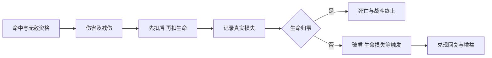

# 战斗系统设计

**阅读范围（文档整理）**：本页保留2026-10-18规则核对与扩展讨论原文，其中45房／40宝物／正式Boss待做等“当前”是历史阶段。现行乘区、事件、混合属性读取、承伤和冷却见[战斗与成长](../战斗与成长.md)；敌方防御、统一命中读取及固定附伤未来承伤仍是待讨论建议，不因已实施通用道具而一并采纳。

日期：2026-10-18。状态：**战斗规则基线与扩展讨论；24件通用道具、暴击无上限及冷却缩减60%已获实施授权，其余新增规范仍待讨论**。

用户已通过[24件通用道具](../历史方案/10-通用道具设计.md)的候选设计。下一步先统一属性、伤害乘区、承伤、触发和敌方规则，让职业法术、道具、后15房与正式Boss使用同一套定义。最终目标保持完整60房含Boss约30分钟，允许成型构筑明显变强。

本稿推荐保留现有伤害主结构：**攻击决定基础量，技能决定系数与命中方式，通用与元素加成各自同桶相加，目标易伤、暴击和防御分别结算。** 新道具不因名字不同就获得新的独立乘区。敌人主要通过行为、空间、密度与阶段机制形成差异，防御作为有显示的可选属性。

## 1 已确认与本次待讨论的边界

| 层级 | 状态 | 内容 |
|---|---|---|
| 战斗方向 | 已确认 | 移动中自动吟唱／施法、八槽三级；法术决定玩法，道具增强机制与强构筑；完整60房及Boss约30分钟 |
| 通用道具 | 已授权全部实施 | 蓝10／紫10／金4，含3件沿用、2件P04／P05迁类、19件新增；实施证据见历史11 |
| 当前范围 | 已确认 | 45房、正式十火、40活跃宝物；玩家防御与通用事件按已认可道具规则接入，敌人暂不新增防御 |
| 属性上限 | 用户明确确认 | 暴击率不设上限；100%起必暴，不增加超暴击；冷却缩减最高60%，最短CD仍为0.2秒 |
| 本稿的乘区规范 | 待讨论 | 攻击百分比口径、易伤统一叠加、敌方防御、属性取值时机、固定附伤的承伤规则 |
| 本稿未确定的内容 | 后续设计 | 新职业、正式Boss招式／血量、46—60遭遇、元素抗性／穿透、韧性条等新系统 |

用户随后明确要求整理文档并实装全部通用道具和图标，实施记录见[历史11](../../历史决策/归档/11-通用道具实装.md)。后续通过并实施的正式火系燃烧／引爆及作用域见[设计13](../历史方案/13-正式火系法术与职业宝物.md)和[历史13](../../历史决策/归档/13-正式火系实装.md)；新状态取当前属性，原直伤／区域快照继续保留。该授权不自动采用额外奖励节点方案；本文对旧行为的其他修改仍标为新增建议。

## 2 角色属性

### 2.1 首轮统一的战斗属性

| 属性 | 单位与含义 | 当前基础或状态 | 建议规则 |
|---|---|---|---|
| 当前生命／生命上限 | 生命点 | 300基础，局外宝石与U01可平加 | 上限增加不自动回血；归零死亡 |
| 当前护盾／护盾上限 | 护盾点 | 100基础；清房补满 | 先盾后血，不另增溢出盾层；普通盾不自带减伤 |
| 攻击力 | 伤害基数 | 100基础；宝石／U03平加 | 与技能系数相乘；不是每次命中的最终伤害 |
| 攻击力百分比 | 百分比 | 尚无通用来源 | 预留，默认0；同类相加，按本节公式统一计算 |
| 临时攻击增益 | 百分比 | F06提供20% | 同一类临时攻击增益相加；保留法阵自身不吃自身增益的例外 |
| 防御值 | 无量纲数值 | 通用道具定义15／30及条件20等来源 | 玩家使用第5节公式；不能把15防御读成15%减伤，敌方防御仍待讨论 |
| 暴击率 | 百分比属性 | 基础5%，不设上限 | 按百分点增加；100%起每个允许暴击的有效伤害分量必暴，超过100%保留数值 |
| 暴击伤害 | 倍率 | 基础1.5倍 | 各项倍率增量相加；当前没有另设通用上限 |
| 冷却缩减 | 百分比 | 基础0，三火相性10%；上限60% | 同桶相加；只减主动法术CD，最终CD不低于0.2秒 |
| 移动速度 | 米／秒 | 基础5 | 已通过的通用设计建议战斗移速增益同桶相加，最高35%；不改变碰撞和受伤无敌 |
| 通用伤害加成 | 百分比 | 已认可道具的条件增伤 | 按命中时状态筛选后同栏相加，再乘现行职业伤害 |
| 元素伤害加成 | 百分比 | 当前只有火伤 | 同一种元素的增伤相加；其他元素有内容时再加入 |
| 生命／护盾回复增幅 | 百分比 | GT01设计只提供护盾回复＋25% | 两类分开；不把回盾增幅套到回血、开场补满或提高上限 |

射程、爆炸半径、投射物数量、穿透、持续时间、召唤数量和击退距离归技能参数。它们可以被职业或通用道具修改，但不默认成为影响所有技能的角色属性。“防御”“护盾”“生命”和“无敌”也不能混写为同一种生存属性。

### 2.2 属性来源与重算

建议显示与结算共同使用以下来源顺序：职业基础 → 局外装备平加 → 本局道具平加 → 百分比属性 → 当前临时效果。来源是记录分类，不意味着每个来源单独乘算。

`静态攻击 =（基础攻击 + 所有攻击平加）×（1 + 所有常驻攻击百分比之和）`

`本次有效攻击 = 静态攻击 ×（1 + 当前临时攻击增益之和）`

常驻攻击百分比是本次预留建议，默认0。临时攻击栏保留现行F06的独立位置，但未来同栏两个20%是40%，不能因为来自两件道具就变成1.2×1.2。

`生命上限 =（基础生命 + 所有生命平加）×（1 + 生命百分比之和）× 明确的上限代价系数`

GT03破誓契约的代价系数为0.8。生命琥珀与契约同持时为（300＋80）×0.8＝304；取得顺序相同。首次契约同比缩放当前生命，之后提高上限不回血；不得每次重算属性又把当前生命乘0.8。属性重算不发送受伤或治疗事件。

生命百分比暂无首轮道具来源，默认0，作为后续扩展位置；不是本次额外新增一组道具。

护盾上限采用同样的平加／百分比分层，但契约不影响护盾。生命和护盾都保留小数结算，显示取整不能回写数值。

### 2.3 属性的作用范围

每份增益还需说明作用范围，先筛选范围，再放入对应属性或乘区。同为暴击率，可以有全局与仅火伤两种来源；不能先全加到一个数值，再让所有元素无条件使用。

| 增益范围 | 例子 | 扩展规则 |
|---|---|---|
| 全局属性 | U03攻击、鹰眼石暴击率 | 对符合该属性的所有常规伤害生效 |
| 元素限定 | F02火伤、火焰魔法书火系暴击、P03火系易伤 | 只对对应元素生效，目标易伤也须筛选元素 |
| 技能与分量限定 | 焰弹爆炸半径、爆弹中心暴伤 | 只改变指定技能或分量，不上升为全局角色属性 |
| 状态限定 | 半血、站定、敌人是精英 | 按本次状态判定，符合后再加入通用栏 |

当前只有火系，部分实现把火系暴击等直接加入玩家属性；未来跨元素时应按原条目文案的范围筛选，不能因旧实现使用全局字段就让冰／其他属性自动继承。若希望某个职业增益帮助其他职业，应明确写进效果，而不是由字段复用意外获得。这一作用域规范同属本次新增讨论。

## 3 伤害乘区

### 3.1 常规伤害的推荐主公式

`伤害 = 有效攻击 × 本次技能系数 × 施法倍率 ×（1 + 通用增伤总和）×（1 + 对应元素增伤总和）×（1 + 目标易伤总和）× 暴击倍率 × 目标承伤系数`

未发生暴击时，暴击倍率为1。目标没有防御等承伤属性时，承伤系数为1。以下是有含义的规则层次，不是为每件新道具增加一项独立乘法。

| 位置 | 放入什么 | 叠加方式与例外 |
|---|---|---|
| 有效攻击 | 角色攻击平加、预留攻击%、法阵等临时攻击 | 按第2节重算；F06自身持续伤害仍排除自己的20%增益 |
| 本次技能系数 | 技能等级系数、中心／外围、单发／持续跳、专属系数修正 | 必须标明修改哪个伤害分量；B03首落、B04常规激光、B07中心不扩到整套技能 |
| 施法倍率 | 本体1、G01余响0.7等 | 决定这次施法的伤害份额，不作为永久属性 |
| 通用增伤 | 完璧、狩猎、对精英、半血、契约、凝定等 | 当前满足条件的数值同桶相加，不逐件相乘 |
| 元素增伤 | 当前火伤、F02、三火、G01火伤等 | 同元素相加；通用和元素仍是两桶，沿用已认可道具设计 |
| 目标易伤 | P03火系区域重叠及未来明确施加在目标上的受伤增幅 | 先筛选作用元素／形态，再同类相加；同名同来源不重复叠；P03自身只判一次 |
| 暴击 | 当前暴击率决定是否触发，基础倍率加暴伤增量 | 不把暴击率当伤害倍率；不把每次命中都当作暴击 |
| 目标承伤 | 防御与符合标签的减伤 | 所有减伤最终汇总一次；见第5节 |

“对精英造成的伤害＋20%”来自攻击者，属于通用增伤条件；“目标受到的伤害＋20%”属于目标易伤。两者即使都提到敌人，也不能因文案相似随意放进不同乘区。

### 3.2 哪些相加 哪些相乘

- 完璧18%＋狩猎18%＝通用36%，倍率1.36。
- F02三级火伤35%＋三火15%＝火伤50%，倍率1.5。
- 通用36%与火伤50%共同作用为1.36×1.5＝2.04；误合成一桶会变1.86，改变已认可的效果收益。
- 暴击伤害基础1.5＋F02三级0.25＝1.75倍。F02的这一项不是暴击率＋25个百分点。
- 同名区域、同一个目标易伤或同一伤害分量不会因为有多个表现对象就再次结算一遍。

保留高收益组合，不设置总输出增长天花板。需要控制的是条件是否真实满足、是否重复计算、是否无上限递归，以及强构筑在最终完整路线中的节奏。

### 3.3 完整计算例子

以F01三级主弹为例，暂用一个**新规则诊断沙包**，不代表当前敌人已经有防御：

| 项目 | 本例取值 |
|---|---|
| 攻击 | 基础100＋U03的15＝115 |
| 临时攻击 | 法阵20%，有效攻击138 |
| 主弹系数 | 1.35；只算主弹，次弹另算 |
| 施法倍率 | 1，本次为自然施法 |
| 通用增伤 | 完璧18%＋狩猎18%＝36% |
| 火伤 | F02三级35%＋三火15%＝50% |
| 目标易伤 | P03满足两种区域重叠，20% |
| 暴击 | 鹰眼后13%概率；F02三级后倍率1.75 |
| 沙包防御 | 20，承伤系数100／120 |

防御前非暴击：`138 × 1.35 × 1.36 × 1.5 × 1.2 = 456.0624`。

防御后非暴击：`456.0624 ÷ 1.2 = 380.052`；暴击：`380.052 × 1.75 = 665.091`。

每次命中的数学期望为`380.052 ×［1 + 0.13 ×（1.75－1）］= 417.10707`。这个期望不能拿来显示每一击，也不等于本次一定打出417点。固定1000生命沙包在这些假设下的命中次数期望为2.7569，不能简单用1000除平均每击伤害代替离散击杀。

例子忽略次弹、飞行、走位、其他技能和事件链，只用于解释乘区。可复算的[公式结果](../../../build/qa/generic-items-implementation-20261018/formulas/results.md)与[工具](../../../tools/balance/combat_foundation/README.md)不决定敌人或Boss最终血量。

## 4 伤害标签与触发资格

### 4.1 一次伤害需要区分的维度

| 维度 | 示例 | 用途 |
|---|---|---|
| 归属 | 玩家、玩家召唤物、敌人、环境 | 击杀归属、敌我和回复来源 |
| 施法来源 | 自然施法、追加施法、余响、道具派生 | 决定哪些事件可以再次触发 |
| 伤害形态 | 飞行弹、光束、范围爆炸、持续区域、接触 | 偏转扣环、碰撞、伤害显示与专项规则 |
| 元素 | 当前火；其他有内容时再定义 | 元素增伤及未来可能的属性交互 |
| 伤害分量 | 主弹、次弹、中心、外围、持续跳 | 系数、专属道具和命中去重 |
| 施法与命中身份 | 同次施法、该次目标、该次伤害分量 | 防止多弹、多目标、多段把一次触发算很多次 |

这些维度互相独立。火属性不自动等于持续伤害；远程攻击不自动等于飞行弹。敌方光束、落印、扑击和冲撞不受偏转扣环的飞行弹减伤。新怪物的弹体附带爆炸时，应明确各个伤害分量的形态，一份伤害只过一次防御。

### 4.2 自然与派生事件

| 来源 | 常规暴击与增伤 | 自然施法计数 | 其他关键边界 |
|---|---|---|---|
| 玩家自然伤害法术 | 可以 | 每次成功施放一次，不按命中人数计 | 直伤暴击可按P02条件生成一次刻印 |
| 自然法术的持续跳伤 | 当前可以暴击 | 不为每跳再计自然施法 | 区域伤害不生成P02刻印；G03只响应合格区域正常到期 |
| 精灵常规激光 | 当前可以暴击 | 每发不计；召唤动作与激光分开 | 不生成P02，不释放GT01蓄能 |
| P04追加／G01余响 | 当前可以暴击并吃常规增益 | 不计，不再生成追加／余响连锁 | 仍保留对应技能效果；现有追加F09可刷新B09移速 |
| P02／G03等系数型道具伤害 | 当前可以暴击并吃常规增益 | 不计 | 不生成新的刻印、余响或同类攻击链 |
| GT01固定蓄能附伤 | 设计为不暴击、不吃第二次进攻增幅 | 不计 | 有效击杀可记一次死亡；承伤侧新规范见下节 |
| 敌方攻击 | 首轮建议保持不随机暴击 | 无 | 用行为、预警和基础伤害形成风险，避免不可读的随机重击 |

自然施法是成功完成主动法术，不是开始吟唱、每个弹体、每次持续跳或每个击杀。场上没有合法结果、吟唱取消、无效召唤不能凭空增加计数。

### 4.3 固定附伤与真实伤害要分清

GT01已认可的是“由实际回盾存入固定蓄能、释放时不再乘攻击／增伤／暴击”的结构。**本次建议细化为：固定的是进攻侧数值，不代表真实伤害；仍须通过目标防御、护盾与合法受击检查。** 当前敌人没有防御和护盾，因此这条细化在现45房不会表现出差异；未来装甲敌人出现后才有区别，须作为本稿讨论点确认。

例如蓄能200，对防御0目标扣200，对防御20目标约扣166.67。它保留元素标签，不因此额外获得火伤或P03倍率。首轮不新增普遍无视防御的真实伤害、反伤连锁或吸血规则。

父法术先结算本体，再检查目标是否存活。若首个有效命中的目标已死、无蓄能或共享间隔未结束，GT01不消费、不起间隔，但本次施法的检查机会已经使用；不转移给穿透后的另一目标。

### 4.4 事件去重与死亡

每次伤害先固定实际损失，再只发一次对应事件。有效击杀只记一次；法术、召唤和道具派生伤害可计正常击杀，但狩猎余温仍受每1秒一次的间隔限制。

派生伤害可以消灭敌人，但不能把这个击杀误认成一次自然施法。恢复量不再算作伤害；回盾形成的蓄能伤害不再反向生成回盾。每个道具明确监听的事件、次数口径、间隔和重置点，不使用“所有命中都触发所有道具”的默认规则。

## 5 防御 护盾 回复与死亡顺序

### 5.1 统一承伤公式

沿用已认可通用道具设计的玩家防御式：

`最终承伤系数 = max［0.55，100 ÷（100 + max（防御，0））× 符合条件的减伤系数］`

玩家全部此类减伤最多45%，作用于护盾和生命；偏转扣环的飞行弹系数为0.82，其他形态为1。防御15约减13.04%，防御30约减23.08%，两件合计防御45约减31.03%；再加飞行弹减伤为43.45%。

**新增建议：敌人也采用这一防御函数与综合上限，默认防御0。** 先以0／20／40作为公式探针，不作为全体怪物或Boss的制作数值。普通怪不因房数提高就自动叠防御，Boss也不默认再乘一层隐藏减伤。

### 5.2 承伤与回复顺序

- 破盾必须从正数降到0。破盾回盾只在本次结算后生效，不能抵消同一击已经造成的生命损失。
- 致死伤害优先于本次受伤触发，复苏吊坠、破盾缎带、共生护杯均不能复活。
- 承伤统计只算实际盾损失＋实际生命损失，过量伤害不计；需要分析减伤时另记原始伤害与减免量。
- 被0.6秒无敌挡下的命中不扣盾／血，不重置完璧，不生成受伤回复；无敌不储存被挡伤害。
- 一次固定步有多个命中时，按稳定命中顺序处理；首个有效承伤开启无敌后，后续命中按当前规则检查，不偷偷改成取最高伤害覆盖。

例如原始100伤害，防御45且是飞行弹，结算约56.55。若当时20盾、50生命，则损失20盾和约36.55生命；之后的回盾／回血只能处理已固定的这一损失记录。

### 5.3 回复计算

`实际生命恢复 = min（本次合格回复量，生命上限－当前生命）`

护盾恢复同理；GT01的＋25%作用于合格的战斗数值回盾，不能把上限提高、开场满盾或清房补满变成一次可储能回复。溢出不累计，复苏吊坠按触发那次生命损失固定总额，后续伤害不重算这份回复。

后续若加入敌方护盾，默认也先盾后血，并要求独立说明补盾来源、阶段重置和破盾事件；当前敌方护盾视为0。防御、盾和阶段无敌必须可被识别，不用三种系统隐蔽叠出同一种“打不动”。

## 6 冷却 吟唱与召唤频率

`有效CD = max（0.2秒，等级基础CD ×［1－min（总冷却缩减，60%）］）`

有基础CD的主动法术使用此式；被动不生成0.2秒主动循环。当前F10三级基础CD为9秒，不能一直按原法术表外层的12秒计算。

每个法术独立：就绪且有合法目标 → 吟唱 → 成功施放 → 开始本技能CD。移动不取消吟唱，也没有八槽共用的施法队列。无合适目标不储存多次施法；附加施法使用独立记录，不重置本体的吟唱或CD。

三火10%加沙漏6个百分点为16%。F01基础CD1.2秒变1.008秒，再加0.15秒吟唱，理想完整循环为1.158秒。不能把16%CDR直接称作每秒伤害＋16%。

P05每8秒把**剩余CD**减半，和缩短基础CD不是同一件事；它不减自身间隔、吟唱、召唤物射击间隔或其他道具间隔。首轮继续使用CDR，不再同时引入“冷却恢复速度”这套分母公式，避免同名概念混用。

召唤物单独定义数量、存续、攻击间隔、目标与贯穿；常规CDR不直接加快每只精灵激光。额外召唤、满员刷新和延长持续需沿用各条目的合法规则，不能因一个通用加速属性同时提升召唤频率、激光频率、数量与存续四次。

## 7 属性在什么时候读取

### 7.1 当前代码是混合读取

当前施法会记录等级系数、几何、施法倍率和法阵攻击增益；攻击力、暴击与火伤在命中时读取，P03也按命中时的区域重叠判断。精灵普通激光沿用召唤记录中的法阵增益；协同激光则另取当时法阵增益。F06自身持续伤害明确把自己的法阵增益设为0。

因此，不能把现有系统笼统称为“全部施法快照”或“全部命中实时”。这些细节在新通用条件、长存续召唤和未来Boss状态加入后，会影响实际收益。

本轮保持上述旧取值；新通用条件增伤、暴伤、防御和低血状态按当次命中／承伤读取。GT01只读真实战斗回盾与首个合格命中，不把回盾转化为普通施法，不重新触发暴击或命中宝物链。

### 7.2 推荐统一口径 作为本次新增建议

| 内容 | 推荐读取时机 | 玩家可预期的行为 |
|---|---|---|
| 等级系数、弹数、半径、落点、持续时间、施法来源与倍率 | 施法成功时固定 | 已发出的技能不因临时属性变化重画范围或追加弹体 |
| 攻击、临时攻击、暴击属性、通用条件增伤、元素增伤 | 每次有效命中／持续跳时读取 | 低血、无伤、站位状态失效后，后续伤害同步失去加成 |
| 敌方防御、易伤、护盾、受击资格 | 该次命中时读取 | 敌人离开重叠区或进入明确状态后，后续伤害跟随变化 |
| 召唤物普通攻击的主人属性 | 每发实际命中时读取 | 不靠一次召唤长期保留已经离开的临时站位增益 |
| GT01储量与上限 | 真实回盾时存入、释放时裁定 | 固定储量不再乘第二次进攻增幅 |

这会改变现行法阵增益的部分快照行为，尤其是长召唤；**只是推荐，须确认后再迁移**。F06不能放大自身持续伤害、附加施法不递归等既有例外继续保留。另一选择是保持现有混合口径并逐技能明确；其优点是旧结果变化小，代价是更多例外需要记忆。

## 8 敌人 精英与Boss扩展

### 8.1 敌方需要管理的字段

| 类别 | 必要信息 | 规则边界 |
|---|---|---|
| 生存 | 生命、可选防御、可选护盾 | 默认盾／防御0；体型或“精英”标签不隐含减伤 |
| 伤害 | 每个攻击的基础伤害、系数、形态与元素 | 现有spec.damage已是该攻击输入，不能迁移时又乘一次敌人攻击力 |
| 行动 | 移速、触发距离、攻击周期、预警、锁向、有效段、后摇 | 提速不能吞掉明确预警；周期不得短于完整动作时间 |
| 控制 | 当前减速、击退抗性、可否打断当前动作 | 当前减速取最强，不相加到定身；击退抗性按距离生效 |
| 身份 | 普通／精英／Boss、召唤归属、阶段 | 供猎首、击杀和阶段规则使用，不自动添加另一乘区 |
| 状态 | 易伤、破盾、阶段受击资格及持续时间 | 玩家能识别来源、剩余时间与反制方式 |

### 8.2 推荐的扩展边界

1. **先保持防御默认0。** 装甲特化敌人可以显式获得防御，但必须在同等生命与行为下单独评估。防御20使同伤害下的资源耐受提高20%，再把生命加20%会成为约44%的叠加耐受，不只是“略硬一点”。
2. **Boss不靠隐藏多乘区撑时长。** 压力可来自招式组合、弹道交叉、攻击窗口与空间，而不是同时追加高生命、高防御、元素抗性和全程减伤。
3. **先不启用元素抗性与穿透。** 预留标签与数据扩展位置；当前只有火职业时，不引入把火系直接卡住的高火抗。未来若启用，明确它与防御、易伤和固定附伤的关系，再定义负抗性／穿透顺序。
4. **控制抗性按动作定义。** 普通怪可被推开，重型／Boss可配置击退抗性；若某动作不能被打断需明确提示，不默认全Boss免疫所有控制。韧性／削韧条另作系统讨论。
5. **阶段不是复活。** 阶段阈值、转场、受击资格、旧弹体／区域如何处理要逐Boss说明；不重复计击杀或反复发阶段奖励。强制锁血或无敌属于明确招式例外，不能用未显示的规则吞掉玩家爆发。

本稿不定Boss最终血量、技能或后15房人数。原目标中的正式Boss尚未实装，当前15／30／45房仍是强化精英。

## 9 战斗外 冻结与跨房

| 状态 | 应推进什么 | 不应推进什么 |
|---|---|---|
| combat | 人物／敌人／法术、回复、间隔、条件层数、战斗与路线计时 | 无 |
| pickup与exit | 玩家领取／走门、路线计时 | 冷却、回血／回盾、无伤、站定、充能、叠层与宝物间隔 |
| reward与artifact | 选卡与路线计时 | 人物、敌人和全部战斗效果 |
| choosing、暂停、失焦、结束 | 界面允许的操作 | 路线和战斗均停，不补算墙钟时间 |

持有法术、等级、道具、当前生命、基础上限和剩余CD跨房保留；清房补满普通护盾。区域、弹体、召唤、自然施法计数、短时移速、无伤／站定／击杀层数、蓄能、失盾累计、周期回复计时等按各道具房内规则清零。破誓契约等持有型属性代价持续整局，不随清场解除。

临时效果不得因为读取路线time而在选卡或走门时偷偷充好；选择动画、粒子和声音不反写数值。

## 10 扩展时的数值与可解释性

完整路线目标仍为60房及Boss约30分钟。应分别记录普通／精英战斗、Boss战斗及转场、清场走位／拾取、选奖时间；当前45房只是阶段对照，不是整局时间预算。

高输出可以更快清掉正常房间，后段与Boss让玩家检验成型构筑。避免一边允许强构筑，一边按玩家面板自动增加每只怪的生命把收益抵消。职业道具价值通过新增交互、覆盖、控制和循环体现，不要求通用道具在所有输出比较中都更弱。

最低限度的角色面板应显示：生命／盾上限、攻击、防御对应减伤、暴击率／倍率、CDR、战斗移速、通用增伤和元素增伤。条件加成另列当前生效项；没有生效的半血或叠层不要合入一个看似永远生效的DPS数字。

验证记录应保留：伤害源与分量、非暴击基础量、当次各桶、是否暴击、减伤前后、实际盾／血损失、过量伤害、真实回复、触发道具及被拒绝的触发理由。表现层只读取这些结果，不能通过动画命中重新计算一次伤害。

## 11 本轮已定与后续讨论

已定并实施的范围：24件通用、通用与职业增伤分桶、同桶相加、玩家防御与恢复事件、不设总输出硬上限、暴击率无上限、冷却缩减最高60%。GT01固定附伤不重吃进攻倍率、不暴击、不触发命中链，但可以正常击杀。目前敌人只有生命承伤。

仍待确认的新增规范：

1. 所有新易伤是否统一同类相加，以及常驻攻击百分比来源的完整重算。
2. 是否统一命中时读取进攻属性，改变既有法阵／长召唤的部分快照。
3. 敌方是否采用相同防御式，默认0、只给显式装甲，不自动增加元素抗性或Boss隐藏减伤。
4. 将来敌方加入防御、盾与无敌时，GT01固定附伤的承伤侧资格如何细化。

这些讨论不推迟已授权的24件实施，不自动扩成46—60房或正式Boss制作。

## 12 核对依据

现行输出：[courtyard_route_run.gd](../../../scripts/core/courtyard_route_run.gd)的resolve_spell_hit；法术／召唤及快照：[route_spell_combat.gd](../../../scripts/core/route_spell_combat.gd)的_cast与_update_spirits；事件权限：[route_artifacts.gd](../../../scripts/core/route_artifacts.gd)的on_cast／on_hit；玩家承伤：[first_room_run.gd](../../../scripts/core/first_room_run.gd)的damage_player；敌人档位与动作：[route_enemy_combat.gd](../../../scripts/core/route_enemy_combat.gd)。

基础参数以当前加载的data为唯一运行源。本文示例不是第二套运行默认值。更新后的[317项公式核对](../../../build/qa/generic-items-implementation-20261018/formulas/results.md)包含288个中性新项的乘式等价案例，并更新暴击无上限与60%CDR；它不能代替真实core、事件链、Boss或完整路线验证。24件实现、原生测试与真实画面统一见[历史11](../../历史决策/归档/11-通用道具实装.md)；旧315项报告按原输入哈希保留。
